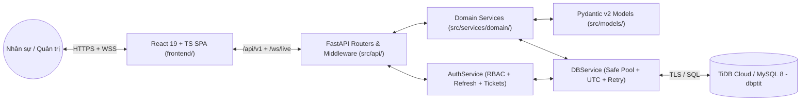

# Architecture (v2.1.0)

## 1. Kiến trúc phân tầng (Modular Monolith)

Hệ thống được tổ chức theo kiến trúc phân tầng rõ ràng nhằm đảm bảo an toàn dữ liệu, dễ kiểm thử độc lập và mở rộng từng phân hệ:

1. **Presentation Layer (`frontend/`):** SPA **React 19 + TypeScript (`strict: true`) + Vite 8 + Tailwind CSS v4** với React Router, TanStack Query, Recharts, Dark Mode, mã thanh toán VietQR chuẩn EMVCo/NAPAS TLV và in nhiệt 80mm. Bản Streamlit kế thừa (`src/app.py`) mặc định chạy chỉ đọc.
2. **API & Real-Time Gateway (`src/api/`):** FastAPI `/api/v1/*` chia thành 8 router chuyên biệt, middleware `X-Request-ID`, Security Headers, Sliding-Window Rate Limiter, CORS allowlist và WebSocket `/ws/live` xác thực bằng single-use ticket (`/auth/ws-ticket`) kèm broadcast song song.
3. **Domain & Auth Services (`src/services/domain/`, `src/services/auth_service.py`):** 6 domain service chuyên trách (`gate`, `infrastructure`, `pass`, `billing`, `directory`, `analytics`) kết hợp `AuthService` (PBKDF2 600k vòng, JWT HS256 kèm `token_version` thu hồi tức thì, refresh token rotation) và facade `ParkingService`.
4. **Canonical Models (`src/models/`):** Pydantic v2 entities ánh xạ đầy đủ 16 bảng `dbptit` và DTO phản hồi API.
5. **Data Access & Migrations (`src/services/db_service.py`, `src/services/migration_service.py`, `src/core/`):** Connection pool `MySQLConnectionPool` chống rò rỉ kết nối, khóa session UTC `+00:00`, retry deadlock/write-conflict TiDB (`1205`, `1213`, `8028`, `9007`), cấu hình hợp nhất `pydantic-settings` và migration có phiên bản (`schema_migrations` + `GET_LOCK`).

## 2. Luồng dữ liệu (Data Flow)

## 3. Lược đồ CSDL `dbptit` (16 bảng + 2 bảng hệ thống)

- **13 bảng nghiệp vụ nền (`Dump20261118.sql`):** `baidoxe`, `khuvucdo`, `vitrido`, `loaiphuongtien`, `loaikhachhang`, `banggia`, `khachhang`, `phuongtien`, `nhanvien`, `thexe`, `vethang`, `luotdo`, `thanhtoan`.
- **5 bảng sản xuất (khởi tạo tự động bởi `MigrationService`):** `taikhoan`, `refresh_tokens`, `ca_lam_viec`, `audit_logs`, `schema_migrations`.

### Quy ước & Ràng buộc chuẩn hóa ở v2.1
- **Độ dài cột sau migration:** `phuongtien.bienso` (`varchar(15)`), `baidoxe.tenbaido` (`varchar(100)`), `baidoxe.diadiem` (`varchar(255)`), `khuvucdo.ten` (`varchar(20)`), `khachhang.hoten` & `nhanvien.hoten` (`varchar(60)`), `thanhtoan.trangthai` & `loaithanhtoan` (`varchar(30)`).
- **Thanh toán (`thanhtoan`):** `idld` cho phép `NULL` (phục vụ thu phí đăng ký/gia hạn vé tháng), `loaithanhtoan` chuẩn hóa `'Tiền mặt'` / `'Chuyển khoản'`, `uk_thanhtoan_idld` chống thanh toán trùng lượt.
- **Múi giờ:** Mọi cột `DATETIME` lưu UTC `+00:00`; thống kê ngày kinh doanh Việt Nam (UTC+7) quy đổi bằng ranh giới UTC sargable (`>= start_utc AND < end_utc`).
- **Trạng thái ô & thẻ:** `vitrido.trangthai` (`1` = Trống, `0` = Đang đỗ, `2` = Bảo trì); `thexe.trangthai` (`1` = Sẵn sàng, `0` = Đang dùng, `2` = Mất/Hỏng).
