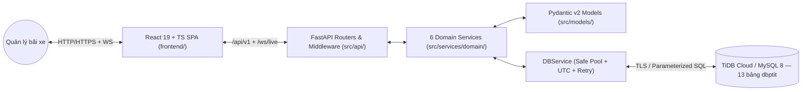
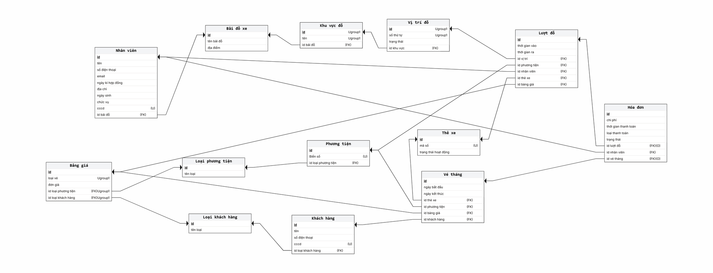

# Architecture (v2.2.0)

## 1. Kiến trúc phân tầng (Modular Monolith)

Hệ thống vận hành theo mô hình **một quản lý duy nhất** trên máy trạm hoặc mạng LAN, tách rõ 5 lớp từ giao diện đến cơ sở dữ liệu quan hệ 13 bảng:

1. **Presentation Layer (`frontend/`):** SPA **React 19 + TypeScript (`strict: true`, `noUncheckedIndexedAccess`) + Vite 8 + Tailwind CSS v4** với React Router, TanStack Query, Recharts, Light/Dark Mode, mã chuyển khoản VietQR chuẩn EMVCo/NAPAS TLV và in nhiệt 80mm.
2. **API & Real-Time Gateway (`src/api/`):** FastAPI `/api/v1/*` (kèm alias `/api/*`) chia thành **7 router chuyên biệt** (`health`, `infrastructure`, `turns`, `billing`, `passes`, `directory`, `analytics`), middleware `X-Request-ID` & Security Headers, CORS allowlist và WebSocket `/ws/live` (kiểm tra origin, heartbeat 90s, broadcast song song). Khi tồn tại `frontend/dist/`, FastAPI phục vụ trực tiếp SPA và fallback History API.
3. **Domain Services (`src/services/domain/`):** 6 domain service chuyên trách (`gate_service.py`, `infrastructure_service.py`, `pass_service.py`, `billing_service.py`, `directory_service.py`, `analytics_service.py`) kết hợp facade `ParkingService` (`src/services/parking_service.py`).
4. **Canonical Models (`src/models/`):** Pydantic v2 entities ánh xạ 1-1 toàn bộ 13 bảng `dbptit` (`entities.py`) và các response DTOs (`responses.py`).
5. **Data Access & Configuration (`src/services/db_service.py`, `src/core/`):** Connection pool `MySQLConnectionPool` tự động thu hồi kết nối an toàn, khóa session UTC `+00:00`, retry deadlock/write-conflict TiDB (`1205`, `1213`, `8028`, `9007`), và cấu hình hợp nhất `pydantic-settings`.

## 2. Luồng dữ liệu (Data Flow)

## 3. Lược đồ CSDL `dbptit` (13 bảng chuẩn ERD)

Toàn bộ lược đồ và dữ liệu nền định nghĩa trong [`Dump20261118.sql`](../Dump20261118.sql), gồm đúng 13 bảng:
- **Hạ tầng & Biểu giá:** `baidoxe`, `khuvucdo`, `vitrido`, `loaiphuongtien`, `loaikhachhang`, `banggia`.
- **Nhân sự, Khách hàng, Xe & Thẻ:** `nhanvien`, `khachhang`, `phuongtien`, `thexe`, `vethang`.
- **Vận hành & Hóa đơn:** `luotdo`, `thanhtoan`.

### Quy ước giao dịch & toàn vẹn dữ liệu
- **Thứ tự khóa chống Deadlock:** Mọi transaction ghi nhiều bảng dùng `with self.db.transaction() as cursor:` và `SELECT ... FOR UPDATE` theo đúng thứ tự `phuongtien -> vitrido -> thexe -> luotdo`.
- **Ghi nhận nhân viên thực hiện (`idnv`):** Check-in ghi `luotdo.idnv`, check-out và đăng ký/gia hạn vé tháng ghi `thanhtoan.idnv` qua `DirectoryService.resolve_employee_id()`. Nếu client không truyền `employee_id`, hệ thống tự suy diễn theo bãi đỗ và chức vụ ưu tiên (*Bảo vệ* cho vào bãi, *Thu ngân* cho thanh toán) với fallback về Quản lý.
- **Thanh toán (`thanhtoan`):** `idld` cho phép `NULL` (cho hóa đơn đăng ký/gia hạn vé tháng gắn `idvt`), `loaithanhtoan` chuẩn hóa `'Tiền mặt'` / `'Chuyển khoản'`, kiểm tra khóa trùng trước khi chèn hóa đơn lượt đỗ.
- **Múi giờ:** Mọi cột `DATETIME` lưu UTC `+00:00`; thống kê ngày kinh doanh Việt Nam (`Asia/Ho_Chi_Minh`, UTC+7) quy đổi bằng ranh giới UTC sargable (`vn_day_utc_bounds()`).
- **Trạng thái ô & thẻ:** `vitrido.trangthai` (`1` = Trống, `0` = Đang đỗ, `2` = Bảo trì); `thexe.trangthai` (`1` = Sẵn sàng, `0` = Đang dùng, `2` = Mất/Hỏng).
- **Chống nhân bản JOIN:** Các truy vấn vé tháng còn hạn dùng `ROW_NUMBER() OVER (PARTITION BY ... ORDER BY ngayketthuc DESC, id DESC)` để đảm bảo quan hệ 1-1 tại thời điểm truy vấn.
